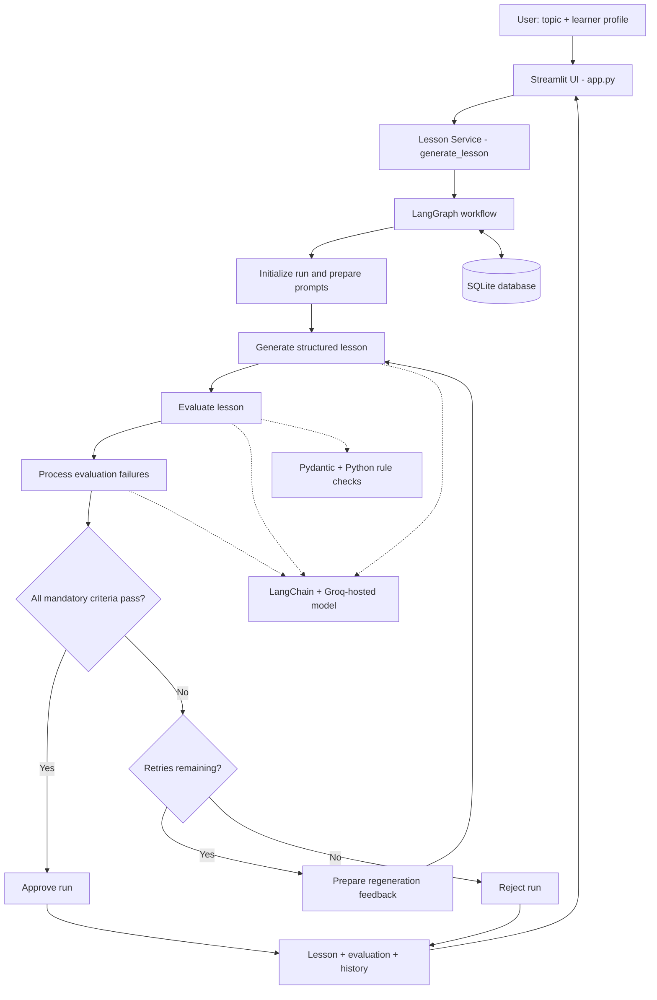
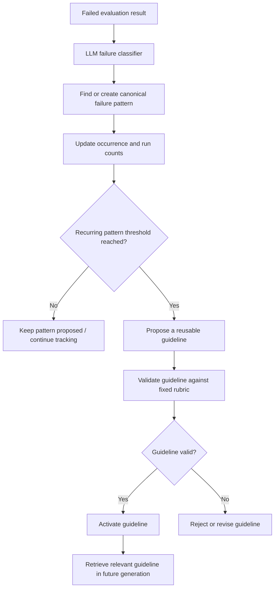

# Self-Evaluating Lesson Content Generator

An agentic AI application that creates beginner-friendly lessons, evaluates them against a strict quality rubric, and regenerates content when it does not meet the required standards. The workflow is bounded: it approves a lesson when all mandatory checks pass, or rejects it when the configured retry limit is exhausted.

The submission topic is **Introduction to Retrieval-Augmented Generation (RAG)**. The system accepts a topic and learner profile so lesson generation can be adapted to the intended audience.

## Table of Contents

- Why this project?
- Key features
- Architecture
- End-to-end workflow
- Evaluation rubric
- Self-evolving memory
- Technology choices and trade-offs
- Project structure
- Setup and installation
- Run the application
- Run tests
- Prompt versioning
- Data and persistence
- Current scope and limitations
- Troubleshooting

## Why this project?

A single LLM call can produce fluent content, but fluency alone does not guarantee that a lesson is accurate, understandable, complete, or suitable for a beginner.

This project treats lesson generation as a quality-controlled workflow rather than a one-shot prompt.

**Generate → Evaluate → Regenerate → Approve or Reject**

The application keeps track of each attempt, records evaluation outcomes, and uses recurring failure patterns to inform future generations.

## Key features

- **Structured lesson generation:** Produces a standalone lesson with an introduction, learning objectives, key concepts, working steps, practical examples, benefits, limitations, glossary, and recap.
- **Learner-aware content:** Accepts the learner's education level, technical background, English proficiency, and learning goal.
- **Hard pass/fail evaluation:** Evaluates each rubric criterion independently; there is no partial credit.
- **Hybrid evaluation:** Combines LLM-based semantic judgment with deterministic Python checks for objective requirements.
- **Bounded regeneration:** Feeds failed criteria and correction guidance back into generation, with a configurable retry limit (the UI allows up to two retries).
- **Rejection history:** Persists failed evaluations and regeneration feedback so attempts can be inspected later.
- **Persistent learning memory:** Groups recurring failures into canonical patterns, validates proposed guidelines, and makes approved guidelines available to future generations.
- **Prompt versioning:** Stores generator, evaluator, and regeneration prompt versions in SQLite.
- **Interactive UI:** Streamlit presents the generated lesson, criterion-wise evaluation, attempt history, and workflow information.

## Architecture

The application is organized into layers so that the interface, workflow orchestration, LLM operations, validation, and persistence have separate responsibilities.



### Main components

| Layer / component | Responsibility |
|---|---|
| **Streamlit (`app.py`)** | Collects the topic and learner profile, starts generation, and displays the lesson, evaluation, and workflow history. |
| **Lesson service** | Provides a single entry point for the UI. It initializes the repository and workflow dependencies, loads reference material, invokes the graph, and returns a result object. |
| **LangGraph** | Owns the workflow state and conditional routing. It coordinates generation, evaluation, memory processing, approval, rejection, and bounded retries. |
| **LangChain + Groq** | Provides the model integration used for lesson generation, semantic evaluation, failure classification, and guideline validation. |
| **Pydantic** | Defines and validates structured lesson, request, and evaluation models so downstream components receive predictable data. |
| **Python rule checks** | Enforce objective conditions such as required content structure and practical-example/key-point checks. |
| **SQLite repository** | Persists runs, lesson versions, rubric criteria, evaluations, rejection logs, prompt versions, and learning-memory records. |

### Why LangGraph?

The workflow is not just a linear chain of prompts. Evaluation can send execution back to regeneration, and that loop must stop after a configured number of retries.

LangGraph makes the workflow state, decision points, and loop explicit. A plain Python function could implement the same behavior, but branching and state management would become harder to inspect as the workflow grows.

## End-to-end workflow

1. **Collect input.** The user supplies a topic and learner profile, including education level, technical background, English proficiency, and learning goal.
2. **Initialize a run.** The service creates a run record, loads the active prompts and rubric, and prepares the workflow state.
3. **Prepare generation context.** The system combines the request, available reference material, and relevant active learning guidelines.
4. **Generate a lesson.** The LLM returns a structured lesson that is validated against the Pydantic `Lesson` schema.
5. **Evaluate the lesson.** The evaluator returns a criterion-wise structured judgment. Python rule checks are also applied to criteria configured for hybrid evaluation.
6. **Process failures.** Failed results are saved. The memory component attempts to classify failures and update recurring patterns; memory processing is separate from the fixed rubric.
7. **Make a decision.** If all mandatory criteria pass, the run is approved. Otherwise, the graph regenerates the lesson with targeted feedback when retries remain. If the retry limit has been reached, the run is rejected.
8. **Return the result.** The UI displays the final lesson when available, evaluation details, attempt history, and workflow status.

## Evaluation rubric

The rubric contains seven criteria. Each criterion receives a **PASS** or **FAIL** result; the system does not award partial credit.

| Criterion | What it checks | Evaluation approach |
|---|---|---|
| Technical accuracy | Concepts and explanations are factually correct and consistent with available reference material. | LLM |
| Beginner friendliness | Explanations are suitable for the stated learner profile. | LLM |
| Practical examples | Examples are meaningful and help the learner connect the concept to a real situation. | Hybrid |
| Jargon handling | Technical terms are explained before or when they are used. | LLM |
| Key-point coverage | Required lesson sections and important concepts are covered. | Hybrid |
| Teaching flow | The lesson progresses in a coherent, easy-to-follow order. | LLM |
| Standalone quality | The lesson can be understood without requiring unstated background knowledge. | LLM |

**Hybrid evaluation** means that the LLM judges semantic quality while Python checks objective structural conditions. A hybrid criterion passes only when both checks pass. The fixed rubric is not automatically rewritten by the learning-memory component.

## Self-evolving memory

The memory system is designed to learn from recurring failures across runs, rather than treating every individual failure as a new permanent instruction.



For example, repeated failures caused by unexplained technical jargon may lead to a proposed guideline such as:

*"Explain a technical term in simple language before relying on it in later sections."*

The guideline is validated before activation and can then be retrieved for future generations.

This design separates three concepts:

- **Failure reason:** What was wrong with one particular lesson.
- **Failure pattern:** A normalized category that groups similar failures across evaluations.
- **Learned guideline:** A reusable instruction intended to reduce that recurring failure.

The rubric remains the quality contract. Memory improves generation guidance; it does not silently lower the quality bar.

## Technology choices and trade-offs

| Choice | Why it was selected | Trade-off |
|---|---|---|
| **LangGraph** | Explicit state, conditional routing, and bounded regeneration loops. | More setup and orchestration concepts than a simple sequential script. |
| **LangChain** | Provides a consistent integration layer for model calls and structured output. | Adds an abstraction and framework dependency. |
| **Groq-hosted LLM** | Provides access to a hosted model through an API, without running the model locally. | Subject to provider rate limits, token-per-minute limits, model availability, and API costs/quotas. |
| **Pydantic** | Validates requests, lessons, and evaluation output at component boundaries. | Strict schemas can reject model output when a field is missing or has the wrong type. |
| **Hybrid evaluation** | Uses an LLM for meaning and Python for deterministic checks. | More code and model calls than relying on a single evaluator. |
| **SQLite** | Simple persistent storage without a separate database server. | Best suited to a small/local application; high-concurrency deployments may need a server database. |
| **Streamlit** | Fast way to build a Python-native demonstration interface. | Less control over complex frontend interactions than a dedicated frontend framework. |
| **Bounded retries** | Prevents endless regeneration and controls cost/latency. | A lesson may be rejected after the retry budget even if another attempt could improve it. |
| **Validated memory** | Reuses recurring corrections while protecting the fixed rubric. | Adds classification/validation calls and only learns robustly when similar failures recur. |

## Project structure

The main folders are organized by responsibility:

```text
AI-Content-Generator/
│
├── app.py                         # Streamlit application
├── content_agent/
│   ├── database/                  # SQLite connection, schema, repository
│   ├── evaluation/                # LLM judge and deterministic rule checks
│   ├── graph/                     # LangGraph state, nodes, routing, workflow
│   ├── llm/                       # Lesson generation and model client
│   ├── memory/                    # Failure classification and guideline learning
│   ├── models/                    # Pydantic request, lesson, and evaluation models
│   ├── prompts/                   # Generator, evaluator, and regeneration prompts
│   └── services/                  # Service entry point for lesson generation
│
├── reference_materials/
│   └── rag_reference.md           # Curated reference material for the RAG topic
│
├── scripts/
│   ├── run_full_workflow.py       # Run the workflow from the terminal
│   ├── live_test_generation.py    # Test live lesson generation
│   ├── live_test_evaluation.py    # Test live evaluation of an unevaluated lesson
│   ├── upgrade_evaluator_prompt.py
│   ├── upgrade_evaluator_prompt_v3.py
│   └── upgrade_generator_prompt.py
│
├── tests/                         # Automated unit and workflow tests
├── .env.example                   # Environment variable template
├── requirements.txt               # Python dependencies
└── README.md
```

## Setup and installation

### Prerequisites

- Python **3.10** (the project has been developed and tested in a Python 3.10 environment).
- A Groq API key with access to the model configured by the project.
- Git, if cloning the repository.

### 1. Clone the repository

```cmd
git clone <YOUR_GITHUB_REPOSITORY_URL>
cd AI-Content-Generator
```

### 2. Create and activate a virtual environment (Windows CMD)

```cmd
py -3.10 -m venv .virtual_env
.virtual_env\Scripts\activate
```

You should see `(.virtual_env)` at the beginning of your terminal prompt.

### 3. Install dependencies

```cmd
python -m pip install --upgrade pip
python -m pip install -r requirements.txt
```

### 4. Configure environment variables

Create a local `.env` file from the provided template:

```cmd
copy .env.example .env
```

Open `.env` and fill in the Groq API key and any model/provider settings defined by the template and the project's configuration module. Keep the variable names from `.env.example` unchanged.

**Security:** Never commit `.env` or expose API keys in source code, screenshots, logs, or public repositories. Keep `.env` in `.gitignore`. Commit `.env.example` with placeholder values only.

### 5. Check the reference material

The default reference file for the RAG submission topic is:

```text
reference_materials/rag_reference.md
```

Make sure this file exists and contains the curated material you want the generator and evaluator to use.

## Run the application

From the project root, with the virtual environment activated:

```cmd
python -m streamlit run app.py
```

Open the local URL shown by Streamlit (typically `http://localhost:8501`).

In the UI:

1. Enter the lesson topic.
2. Set the learner profile and learning goal.
3. Choose the maximum number of regeneration attempts (0–2 in the current UI).
4. Select **Generate and Evaluate Lesson**.
5. Review the generated lesson, criterion-wise evaluation, and workflow details in the tabs.

### Run from the command line

To execute the configured end-to-end workflow without the Streamlit UI:

```cmd
python -m scripts.run_full_workflow
```

The example script uses the Introduction to RAG topic and a beginner learner profile.

### Run individual live checks

Generate and persist a new lesson:

```cmd
python -m scripts.live_test_generation
```

Evaluate a lesson version that has not already been evaluated:

```cmd
python -m scripts.live_test_evaluation
```

The live evaluation script intentionally prevents evaluating the same lesson version more than once. Generate a new lesson or select another unevaluated version before running it again.

## Run tests

Run the complete automated test suite:

```cmd
python -m pytest -q
```

Run only the LangGraph workflow tests:

```cmd
python -m pytest tests\test_workflow.py -v
```

The workflow tests cover first-attempt approval, regeneration followed by approval, rejection after the retry limit, and rejection when zero retries are allowed. Other test modules cover models, database/repository behavior, prompt builders, generation, evaluation, and memory logic.

Use `python -m pytest` from the project root so Python resolves the package consistently in Windows CMD.

## Prompt versioning

Generator, evaluator, and regeneration prompts are stored as versioned records in SQLite. This makes prompt changes traceable and allows the application to load the active version for a workflow run.

The repository includes scripts for upgrading evaluator and generator prompts. For example:

```cmd
python -m scripts.upgrade_evaluator_prompt_v3
python -m scripts.upgrade_generator_prompt
```

Run an upgrade script only when you intend to activate that prompt version. Prompt upgrades affect future workflow runs; they do not retroactively change lessons or evaluations already stored in the database.

## Data and persistence

SQLite is used to persist the workflow and support traceability across runs. The database layer includes records for:

- **Runs:** One record for each user-requested workflow execution.
- **Lesson versions:** Each generated attempt within a run.
- **Rubric criteria:** The fixed criteria used for evaluation.
- **Evaluations:** Criterion-wise verdicts, evidence, failure reasons, and proposed fixes.
- **Rejection logs:** Feedback associated with rejected attempts and regeneration.
- **Prompt versions:** Generator, evaluator, and regeneration prompt history.
- **Failure patterns and validations:** Recurring failure categories, their evidence, and validation decisions for learned guidelines.

Run IDs and lesson-version IDs are database identifiers that increase across the application. They are not attempt numbers. Attempt numbering starts again for each new run; a retry creates another lesson version under the same run.

## Current scope and limitations

- **Reference material is currently file-based.** The service loads the curated Markdown reference file `reference_materials/rag_reference.md` by default. This implementation does not currently include a general document-ingestion pipeline, embeddings, vector database, or semantic retrieval over arbitrary uploaded documents.
- **Reference selection is not yet fully topic-aware.** When no explicit reference material is supplied, the default RAG reference file is loaded. For unrelated topics, replace or extend this behavior before treating the application as a general-purpose multi-topic content platform.
- **LLM output is provider-dependent.** Structured-output calls can fail when the model returns a field with the wrong type, omits a required field, reaches its completion limit, or exceeds provider rate/TPM limits. The prompts and Pydantic schemas must remain aligned.
- **The current application is a local/demo-scale system.** SQLite and Streamlit keep deployment simple, but a multi-user production deployment may require a server database, authentication, concurrency controls, background execution, observability, and API-cost controls.
- **External API interruptions need operational handling.** A workflow interrupted by a provider or network error may leave a run record in an in-progress state unless the exception path marks it as failed. This is distinct from a lesson being rejected by the rubric.

## Troubleshooting

| Problem | What to check |
|---|---|
| `ModuleNotFoundError: No module named 'content_agent'` | Run commands from the repository root and use module execution, for example `python -m scripts.run_full_workflow`. |
| `Copy-Item is not recognized` | `Copy-Item` is a PowerShell command. In Windows CMD, use `copy .env.example .env`. |
| Missing API key / authentication error | Confirm `.env` exists, the variable names match `.env.example`, and the key is valid. Restart Streamlit after changing environment configuration. |
| Structured-output schema error | Compare the Pydantic model field type with the active prompt instructions. Strings, lists, and nullable fields must be described consistently. Activate the intended prompt version and rerun. |
| Completion-length error | Reduce the amount of reference/lesson text sent to the evaluator or shorten the requested output while keeping required structured fields. |
| Groq 413 / TPM error | The request exceeded the provider's tokens-per-minute allowance. Reduce prompt/context size and output-token reservation, or retry after the provider's rate window resets. This is a throughput limit, not necessarily a model context-window error. |
| Live evaluation says a lesson was already evaluated | The script only evaluates an unevaluated lesson version. Generate a new lesson or select an unevaluated version. |

## Contributing and development notes

- Keep the rubric fixed and explicit; do not let automatic memory silently weaken pass conditions.
- Add or update tests when changing workflow routing, evaluation rules, schemas, or memory behavior.
- Create new prompt versions for meaningful prompt changes instead of editing historical records.
- Keep secrets and local database files out of version control.
- Prefer deterministic Python checks for objective conditions and reserve LLM evaluation for semantic judgments.

---

**Built with Python, LangGraph, LangChain, Groq, Pydantic, SQLite, and Streamlit.**